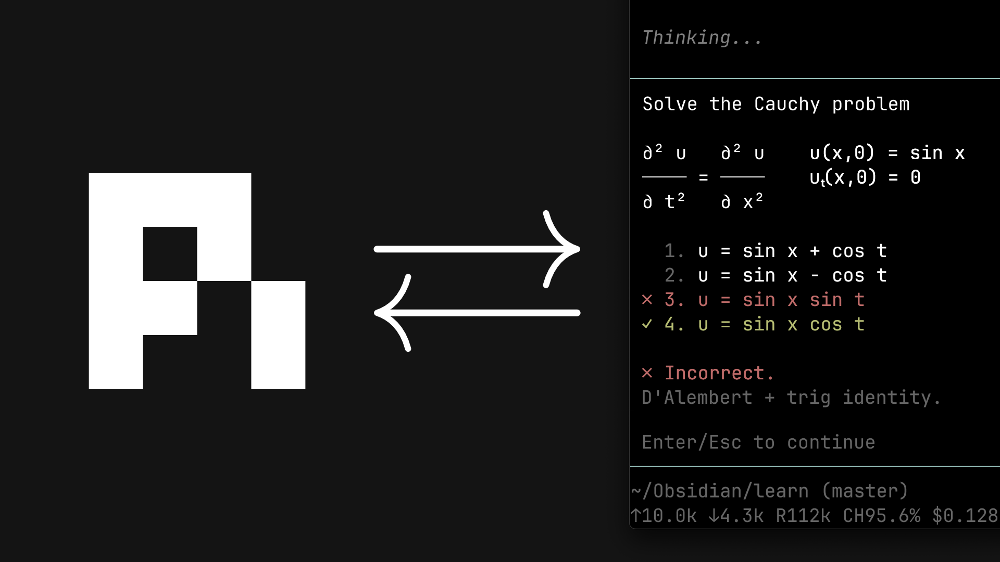

# learn

[](https://www.youtube.com/watch?v=kzcI5F4tGiU)

This is a port of [amosblomqvist's learning system](https://github.com/amosblomqvist/learn) — his AI setup from the video [How I Use AI to Learn Things](https://www.youtube.com/watch?v=kzcI5F4tGiU), originally built as [pi](https://github.com/earendil-works/pi) configuration.

The teaching philosophy, the skills, and the system design are all his; this repo adapts that pi configuration to [OpenCode v2](https://opencode.ai/v2/docs/).

Differences between this repo from upstream is listed in [differences from upstream](#differences-from-upstream) section

> [!WARNING]
> This repo is still in experimental phase. Some stuffs may not work/break.

## What's in it

One plugin package, `oc-learn` (the repo root). Its `package.json` maps two exports to the plugin parts:

- `.` → `plugins/index.ts` — the **server** part, plugin id `oc-learn`. It registers the bundled agents and skills at setup, adds the quiz and viz tools, and runs the md-link mirror.
- `./tui` → `plugins/tui.ts` — the **TUI** part, plugin id `oc-learn.tui`. It registers the slash commands and the `ctrl+alt:m` binding.

Inside:

- `skills/teach/SKILL.md` — the philosophy and the process
- `skills/visualize/SKILL.md` — adds a correct, minimal diagram to a lesson when an idea is clearer as a picture
- `plugins/agents.ts` — `researcher`, `svg-maker`, `mermaid-maker`: the subagents the plugin registers
- `plugins/quiz.ts` — the graded `quiz_ask` / `quiz_grade` question pair (chat-UI mode via `openchamber_render` with auto-detection; TUI session forms in form mode)
- `plugins/viz/` (`index.ts`, `tui.ts`, `common.ts`) — the `write_*`/`edit_*`/`render_*` authoring loops the visual makers use (SVG via `rsvg-convert`, fallback ImageMagick; Mermaid via `mmdc`) and the `/viz-dir` TUI command
- `plugins/md-link/` (`index.ts`, `tui.ts`, `core.ts`) — live-mirrors the session to a markdown file for comfortable reading in Obsidian (assistant replies, your prompts, and quiz Q&A as callouts) plus its TUI commands

## Install

Requires OpenCode v2. Clone this repo anywhere, then load the package in one of two ways.

**Explicit config entry** — works from any path. Add the package directory to `plugins` in your project `opencode.json(c)` or `~/.config/opencode/opencode.json(c)`:

```jsonc
{
  "plugins": ["/home/you/code/oc-learn"],
}
```

Relative paths resolve from the config file that contains the entry, and `file://` URLs work too. A single-file path is skipped — point the entry at a directory.

**Auto-discovery** — place the package directory directly inside a discovered plugins directory:

```text
<project>/.opencode/plugins/oc-learn/
~/.config/opencode/plugins/oc-learn/
```

Immediate package directories under those locations load automatically. A `plugins/` directory beside a project-root `opencode.json(c)` is **not** discovered automatically — use `.opencode/plugins/` or an explicit entry.

One entry loads both parts. The package's `package.json` `name` + `exports` decide which file is the server part and which is the TUI part, and the TUI part loads from the server plugin's entry — no `cli.json` entry and no per-plugin TUI flag. There is no install step: the plugin is TypeScript source loaded by OpenCode, and its only dependencies are `@opencode/plugin` and `@opencode/client`. Use versions of those packages compatible with the OpenCode release you target, and test the installed package rather than only a linked copy.

Visuals publish into the session project's `viz/` by default — the project dir is captured once when the plugin sets up (`ctx.location.directory`), so publishes resolve against it even if the process cwd differs. To always publish somewhere else (an Obsidian vault, say), run `/viz-dir` in the TUI — or point `~/.config/opencode/viz-state.json` at it directly; the override still wins, and empty or missing means the project dir:

```json
{ "defaultDir": "/home/you/Notes/viz" }
```

md-link keeps its own state next to it in `~/.config/opencode/md-link-state.json` (`defaultDir`, `keep`, `persist`, and the enabled sessions).

## Quiz modes

`quiz_ask` has two transports. **Chat-UI mode** returns the question plus a ready `openui-lang` program for `openchamber_render`; OpenChamber renders it, returns the chosen letter(s) and any note, and the model relays them to `quiz_grade(selected, note)`. The question, its details and the lettered option texts all render inside the callout (markdown, so LaTeX works there), while the Choice buttons stay plain letters (A, B, C…); a letter resolves to the shuffled option value through the same letter/value logic as before. Without that tool the result includes a plain-text lettered fallback.

No synchronous HTML/KaTeX transport ships: a plugin-POSTed page is never displayed (the chat draws only `openchamber_render` tool-call pages) and an inlined-KaTeX page exceeds OpenChamber's `render.html` 200 000-character page cap.

**Form mode** (TUI, and `auto` when chat detection fails) is a hybrid: the session form carries only lettered options (A, B, C…, plus "...?") and a note field, with the fixed title "Quiz — answer the question shown in chat". The full question, its details and the lettered option texts come back in the `quiz_ask` result, which tells the model to post that block as a chat message (markdown; math renders per the TUI's own pipeline). The form opens before that message can appear, so the user may see the lettered form first — an accepted ordering wrinkle of the ruling. Form grading uses the same letter/value resolution as chat.

The plugin option `mode` is `"auto"` (default), `"chat"`, or `"form"`:

```jsonc
{
  "plugins": [
    { "package": "/home/you/code/oc-learn", "options": { "mode": "auto" } },
  ],
}
```

`auto` detects `openchamber_render` in the session's tool catalog (memoized per session): present → chat, absent → form. If detection fails or has not run yet, it degrades to chat — a plain-text question still works there, while an invisible form does not.

## Requirements

- [OpenCode v2](https://opencode.ai/v2/docs)
- `rsvg-convert` (librsvg) or ImageMagick — SVG rendering
- `mmdc` (`@mermaid-js/mermaid-cli`) on PATH — Mermaid rendering
- [Bun](https://bun.sh) only for development: `bun install`, then `bun x tsc --noEmit` to typecheck
- Subagents inherit the session's model — edit `plugins/agents.ts` to tune them
- For quizzes: nothing extra — chat-UI mode auto-detects `openchamber_render` (OpenChamber) and otherwise uses OpenCode v2's native TUI forms. See [Quiz modes](#quiz-modes) to force one.

## Notes

- The teaching flow: `teach` probes your level with graded quizzes (`quiz_ask`/`quiz_grade`), plans a dependency map, then teaches node by node with a quiz check after each one. Non-graded questions use OpenCode's built-in `question` tool.
- Visuals are never hand-faked: the skill briefs a maker subagent, which authors, renders to PNG, **looks at the result**, iterates, and only then publishes into `viz/` for embedding.
- `md-link` mirrors only reading-relevant content: your prompts, lesson prose, and quiz Q&A. Tool noise (bash, reads, edits) is omitted. It is event-driven: assistant text is rewritten in place at most every 2.5 s while streaming, the final reply is written when the stream ends, and user prompts are mirrored as they are enqueued. Commands: `ctrl+alt:m` or `/md-link [dir]` toggles the focused session (ON backfills the last 10 messages — replies and your prompts), `/md-link-dir` sets the default output directory, `/md-link-keep` keeps only the N newest replies, and `/md-link-persist [on|off]` keeps mirrors across TUI restarts and auto-resumes them on next launch. `/md-link` OFF still deletes immediately.
- The maker and researcher agents are registered with deny-all permissions plus only the few actions they need. Under v2's last-match-wins permission rule, a later permissive global permission can widen that sandbox; the plugin cannot pin it, so keep global `allow` rules narrow if you rely on it.
- The makers render but the tools return a path, not an image — `render_*` returns the PNG path and the maker opens it with `read` to inspect. Same verify-by-looking loop, one extra step.
- You can run the system without subagents: the main session does the teaching. You lose the researcher (truth verification) and the generated visuals.

## Differences from upstream

New in this port:

- **Single plugin package** — the server and TUI parts ship as one `oc-learn` package loaded through the `plugins` config (or plugin-directory auto-discovery); agents and skills are registered by the plugin itself. Upstream was `git clone` as `.pi` only.
- **Configurable viz output** — `viz-state.json` (`defaultDir`) sends published visuals to any directory; upstream always wrote to `<cwd>/viz`.
- **md-link TUI commands** — `ctrl+alt:m` / `/md-link` with per-session enable, plus `/md-link-dir`, `/md-link-keep`, and `/md-link-persist`; upstream had `/md-log` / `/md-unlog` commands only.

Behavior changes:

- **quiz is two tools** — `quiz_ask` poses the question, `quiz_grade` carries the answer. The TUI shows raw tool arguments, so splitting at the answer boundary makes the correct answer structurally invisible until after you answer (upstream hid it inside the popup renderer).
- **No `ask-user-question` extension** — OpenCode v2's built-in `question` tool covers non-graded questions.
- **No subagent extension** — v2's built-in `subagent` tool replaces `pi-interactive-subagents` (upstream's recommended tmux-only dependency).
- **Render-and-inspect via path** — `render_*` returns the PNG path and the maker opens it with `read` (upstream returned the image inline).
- **Linux-first rendering** — `mmdc` / `rsvg-convert` from PATH instead of a bundled mermaid-cli and macOS Chrome paths.

## Credits

- **amosblomqvist** — original system, teaching philosophy, and video: [amosblomqvist/learn](https://github.com/amosblomqvist/learn) (pi configuration)
- This repository — OpenCode v2 port of that pi configuration; the port mechanics (the plugin package, chat-UI/forms quiz, TUI commands) are the only new work here
